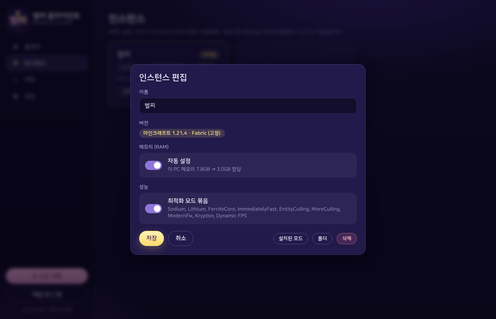
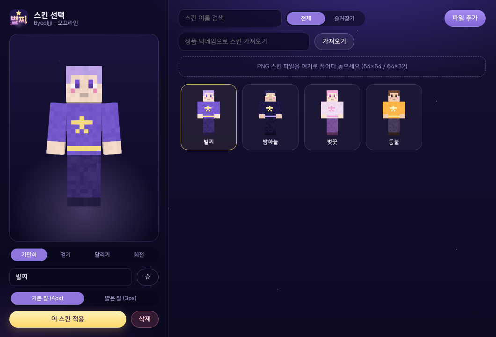

  

<h1 align="center">Byeoljji Client (별찌 클라이언트)</h1>

  A free, lightweight launcher for Minecraft: Java Edition on Windows 
  Windows용 무료 마인크래프트 자바 에디션 최적화 런처

---

## About

Byeoljji Client is a personal project: a desktop launcher for **Minecraft: Java Edition** on Windows that makes the game run smoother and easier to set up. It installs well-known optimization mods automatically, tunes memory settings for your PC, and lets you manage several game profiles and your skin in one place.

> **Status:** Early development. A working test version comes first, and features will be refined over time.

## Features

- **Microsoft account sign-in**: Sign in with your Microsoft account. Only players who own Minecraft: Java Edition can play. Offline/cracked accounts are not supported.
- **Automatic optimization mods**: Installs existing, publicly available performance mods with one click.
- **RAM / JVM auto-tuning**: Picks memory and Java arguments based on your PC's specs.
- **Multiple profiles**: Create and manage separate instances for different versions and mod sets.
- **Skin manager**: Upload a skin file (64×64 or 64×32 PNG), choose the Classic or Slim model, and apply it directly to your Minecraft account.

### In-game features (via existing mods)

Byeoljji Client does not ship its own gameplay mods. It bundles a curated set of existing mods that provide:

- Freelook camera (hold ALT)
- Movable scoreboard
- FPS and ping display
- Adjustable hand position and fire overlay position

## Screenshots

<!-- 테스트 버전 화면을 캡처해서 assets 폴더에 넣고 아래 경로를 맞춰주세요 -->
| Home | Profiles | Skins |
|---|---|---|
|  |  |  |

## How sign-in works

Byeoljji Client uses the official Microsoft sign-in flow:

1. You sign in on Microsoft's own login page. The launcher never sees your password.
2. The launcher verifies through Xbox Live and Minecraft Services that your account owns Minecraft: Java Edition.
3. Your profile (username, UUID, skin) is loaded, and the game is launched with your session.

Login tokens are stored only on your own PC.

## Requirements

- Windows 10 or 11
- A Microsoft account that owns Minecraft: Java Edition

---

## 한국어 소개

별찌 클라이언트는 Windows용 마인크래프트 자바 에디션 런처예요. 최적화 모드 자동 설치, RAM/JVM 자동 설정, 여러 프로필 관리, 스킨 파일을 넣으면 계정 스킨에 바로 적용되는 스킨 관리 기능을 제공합니다. Microsoft 정품 로그인을 사용하며, 정품을 보유한 플레이어만 플레이할 수 있어요.

---

## Disclaimer

NOT AN OFFICIAL MINECRAFT PRODUCT. NOT APPROVED BY OR ASSOCIATED WITH MOJANG OR MICROSOFT.

Minecraft is a trademark of Mojang AB. All mods included through the launcher belong to their respective authors and are used under their licenses.
