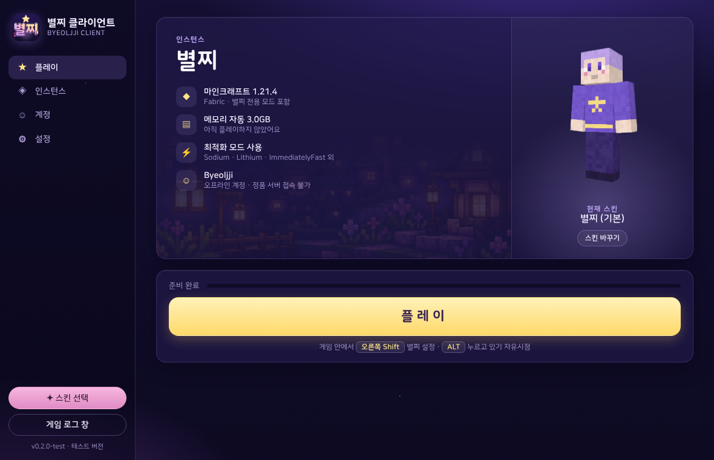
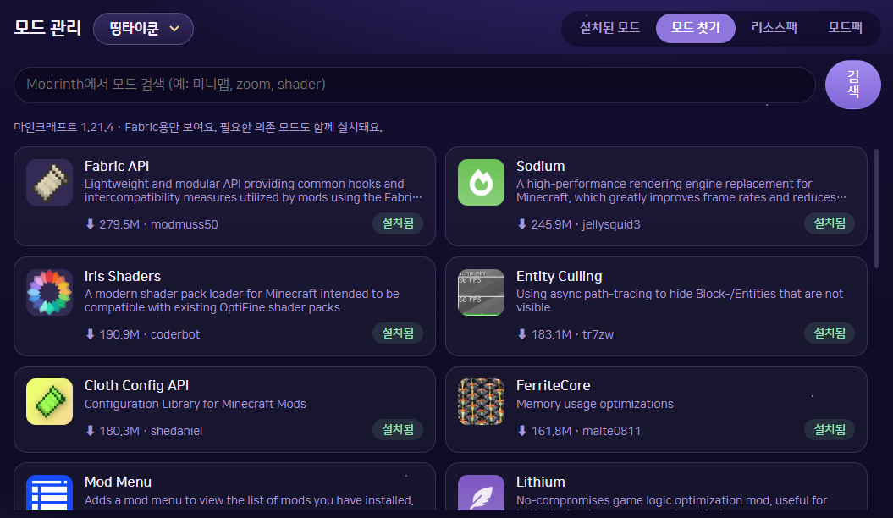

  

<h1 align="center">별찌 Client</h1>

  A free, lightweight launcher for Minecraft: Java Edition on Windows 
  Windows용 마인크래프트 자바 에디션 최적화 런처

  
  
  

  <a href="#english">English</a> · <a href="#한국어">한국어</a>

---

## About

**별찌 Client (Byeoljji Client)** is a launcher that makes Minecraft 1.21.4 lighter and easier to play.
Sign in with your Microsoft account, and performance mods are installed automatically. In game, the built-in 별찌 settings menu lets you adjust your HUD and quality-of-life features right away.

## Features

### Launcher
- **Microsoft account sign-in**: Uses Microsoft's official login page. Your password is never shared with the launcher.
- **Automatic performance mods**: Sodium, Lithium, FerriteCore, ImmediatelyFast, EntityCulling, ModernFix, and more
- **RAM / Java auto-tuning**: Picks memory and Java arguments for your PC. You can also change them in Settings.
- **Instances (profiles)**: Keep separate versions and mod setups
- **Mod browser**: Search and install mods from Modrinth
- **Resource packs**: Enable/disable, reorder, add and remove
- **Skin manager**: Add a skin file (64×64 PNG), choose Classic or Slim, and apply it to your account instantly
- **Server list**: Player count and ping, one-click join, desktop shortcuts
- **Discord Rich Presence**: Shows which server you're playing on (can be turned off)

### In game (별찌 mod)
Open with **Right Shift** or the **✦ 별찌 Client Settings** button on the pause screen.
- **Freelook**: Hold ALT to look around your character
- **HUD**: Move FPS / ping / coordinates, armor durability, effects and scoreboard anywhere
- **Hand and fire overlay position**
- **Chat tweaks**: Longer chat history, stacking repeated messages, and more
- **별찌 title screen**: Night-sky themed title screen (can be turned off)

### Server modpacks
- **DdingTycoon modpack**: Pick only the mods you want, and choose JourneyMap, Xaero's Minimap, or no minimap.

## Screenshots

| Home | Mods | In-game settings |
|---|---|---|
|  |  |  |

## Installation

1. Download the latest `별찌Client-1.0.0.zip` from **Releases**.
2. Extract it anywhere (e.g. `Documents\별찌 Client`).
3. Run **`별찌 Client.exe`** inside the folder.
4. Sign in with your Microsoft account in **Accounts**, then press **Play**.

> **Note:** `별찌 Client.exe` needs the `app` folder next to it. Don't move the exe by itself — create a shortcut instead.

### If "Windows protected your PC" appears
The launcher is not code-signed yet, so Windows shows this warning. Click **More info → Run anyway**.

### Updating
Download the new zip and **extract it over the same folder**. Your accounts, instances and settings are kept.

## Requirements

- Windows 10 or 11 (64-bit)
- A Microsoft account that owns Minecraft: Java Edition
- Internet connection (the game and mods are downloaded on first launch)
- No separate Java installation needed

## Sign-in and privacy

- You sign in on Microsoft's official login page. The launcher never sees or stores your password.
- Login tokens are stored **only on your PC** and are never sent to any 별찌 Client server.
- Offline (cracked) accounts are not supported.

## Troubleshooting

- Check error details in the launcher's **Game Log** menu.
- Open an **Issue** in this repository with your symptoms and log.

## Changelog

### 1.0.0 (2026-10-17)
- First public release
- Microsoft account sign-in
- Automatic performance mods; instance, mod, resource pack, skin and server management
- 별찌 mod 1.0.0 (freelook, HUD editor, hand/fire position, chat tweaks, 별찌 title screen)
- DdingTycoon modpack 1.1.1
- Discord Rich Presence

---

## 소개

별찌 Client는 마인크래프트 1.21.4를 더 가볍고 편하게 즐기기 위한 런처예요.
Microsoft 정품 계정으로 로그인하면 최적화 모드가 자동으로 설치되고, 게임 안에서는 별찌 전용 설정 창으로 HUD와 편의 기능을 바로 조절할 수 있어요.

## 주요 기능

### 런처
- **Microsoft 정품 로그인**: Microsoft 공식 로그인 화면을 사용해요. 비밀번호는 런처에 전달되지 않아요.
- **최적화 모드 자동 설치**: Sodium, Lithium, FerriteCore, ImmediatelyFast, EntityCulling, ModernFix 등
- **RAM·Java 자동 설정**: PC 사양에 맞춰 메모리와 Java 인수를 정해줘요. 설정에서 직접 바꿀 수도 있어요.
- **인스턴스(프로필) 관리**: 버전과 모드 구성을 따로 나눠서 관리
- **모드 찾기**: Modrinth에서 모드를 검색하고 바로 설치
- **리소스팩 관리**: 켜기·끄기, 순서 바꾸기, 추가·삭제
- **스킨 관리**: 스킨 파일(64×64 PNG)을 넣고 클래식·슬림을 고르면 계정 스킨에 바로 적용
- **서버 목록**: 인원·핑 확인, 원클릭 접속, 바탕화면 바로가기 만들기
- **디스코드 활동 상태**: 어느 서버에서 플레이 중인지 디스코드에 표시 (끄기 가능)

### 게임 안 (별찌 모드)
**오른쪽 Shift** 또는 ESC 화면의 **✦ 별찌 Client 설정** 버튼으로 열 수 있어요.
- **자유시점**: ALT를 누르고 있으면 캐릭터 주변을 둘러보기
- **HUD**: FPS·핑·좌표, 갑옷 내구도, 효과, 스코어보드를 원하는 위치로 이동
- **손·불 효과 위치 조정**
- **채팅 편의 기능**: 채팅 기록 늘리기, 같은 메시지 묶기 등
- **별찌 첫 화면**: 밤하늘 테마 타이틀 화면 (설정에서 끄기 가능)

### 서버 전용 모드팩
- **띵타이쿤 모드팩**: 필요한 모드만 골라서 설치하고, 미니맵은 JourneyMap·Xaero 중 선택하거나 빼도 돼요.

## 설치 방법

1. **Releases**에서 최신 버전의 `별찌Client-1.0.0.zip`을 받아요.
2. 원하는 곳에 압축을 풀어요. (예: `문서\별찌 Client`)
3. 폴더 안의 **`별찌 Client.exe`**를 실행해요.
4. **계정** 메뉴에서 Microsoft 계정으로 로그인하고 **플레이**를 누르면 끝!

> **주의:** `별찌 Client.exe`는 옆에 있는 `app` 폴더가 있어야 실행돼요. exe 파일만 따로 옮기지 말고, 바로가기를 만들어서 쓰세요.

### "Windows의 PC 보호" 창이 뜨면
개인이 만든 프로그램이라 코드 서명이 없어서 뜨는 안내예요. **추가 정보 → 실행**을 누르면 실행돼요.

### 업데이트
새 버전 zip을 받아서 **같은 폴더에 덮어쓰기**하면 돼요. 계정, 인스턴스, 설정은 그대로 유지돼요.

## 요구 사항

- Windows 10 또는 11 (64비트)
- 마인크래프트 자바 에디션을 보유한 Microsoft 계정
- 인터넷 연결 (첫 실행 때 게임과 모드를 내려받아요)
- Java는 따로 설치하지 않아도 돼요.

## 로그인과 개인정보

- 로그인은 Microsoft 공식 로그인 페이지에서 진행돼요. 런처는 비밀번호를 보거나 저장하지 않아요.
- 로그인 정보(토큰)는 **내 PC에만** 저장되고, 별찌 Client 쪽 서버로 보내지 않아요.
- 오프라인(비정품) 계정은 지원하지 않아요.

## 문제가 생기면

- 런처의 **게임 로그** 메뉴에서 오류 내용을 확인할 수 있어요.
- 이 저장소의 **Issues**에 증상과 로그를 함께 남겨주세요.

## 변경 사항

### 1.0.0 (2026-10-17)
- 첫 정식 배포
- Microsoft 정품 로그인 지원
- 최적화 모드 자동 설치, 인스턴스·모드·리소스팩·스킨·서버 관리
- 별찌 모드 1.0.0 (자유시점, HUD 위치 편집, 손·불 위치, 채팅 편의, 별찌 첫 화면)
- 띵타이쿤 모드팩 1.1.1
- 디스코드 활동 상태

---

## Credits / 크레딧

All mods and resource packs installed by 별찌 Client belong to their respective authors and are used under their licenses. Mods are downloaded from [Modrinth](https://modrinth.com).

별찌 Client가 설치해 주는 모드와 리소스팩은 모두 각 제작자의 작품이며, 각자의 라이선스를 따릅니다.

## Disclaimer

NOT AN OFFICIAL MINECRAFT PRODUCT. NOT APPROVED BY OR ASSOCIATED WITH MOJANG OR MICROSOFT.

공식 마인크래프트 제품이 아닙니다. Mojang 또는 Microsoft가 승인하거나 관련된 제품이 아닙니다.
Minecraft is a trademark of Mojang AB.
